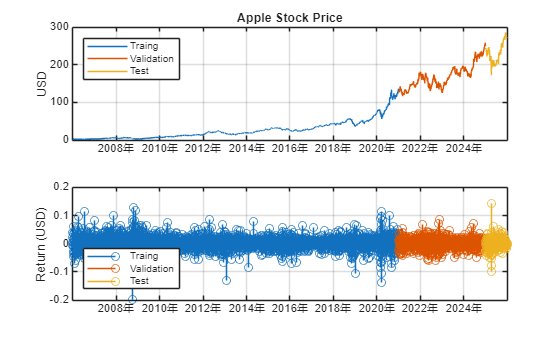
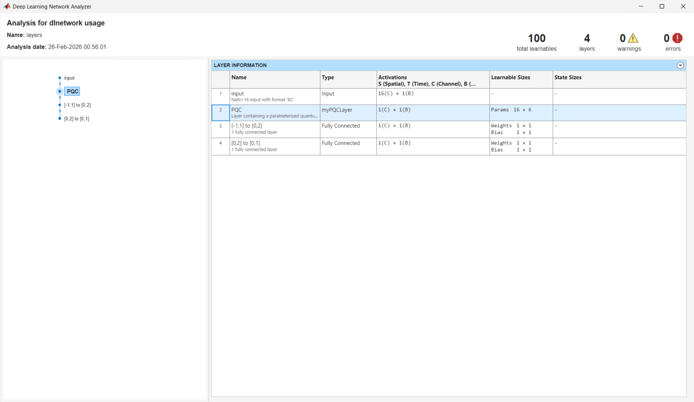
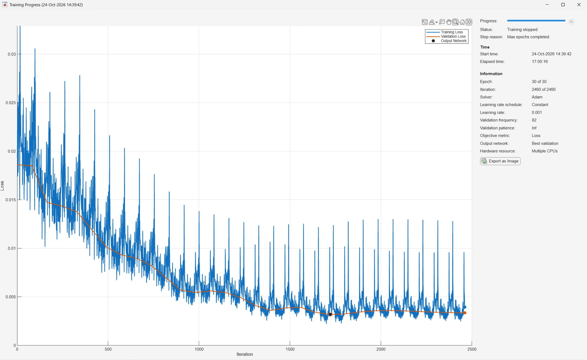
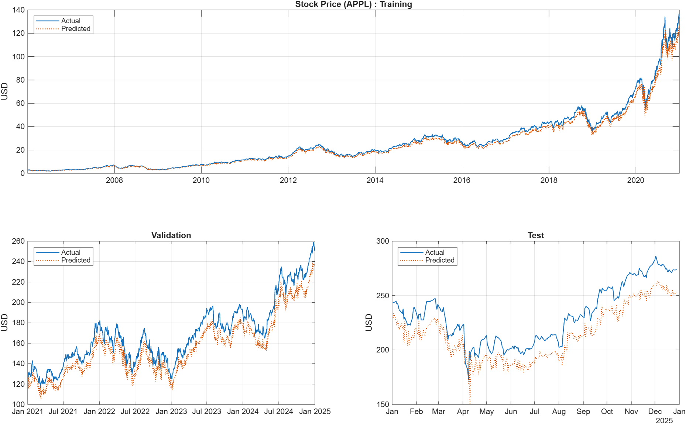

# Time series regression analysis for financial data using quantum neural network 

This script (script_train_logreturn_qnn_model_on_classic_computer.mlx), based on reference [\[1\]](#PaperTimeSerires), 
creates a quantum neural network model (QNN) to predict Apple's stock price using [MATLAB&reg; Support Package for Quantum Computing](https://www.mathworks.com/matlabcentral/fileexchange/125425-matlab-support-package-for-quantum-computing).

This script requires the Deep Learning Toolbox&trade;, Statistics and Machine Learning Toolbox&trade;, 
Parallel Computing Toolbox&trade;, and the above support package in addition to MATLAB.
To check if the required toolboxes are installed, run `ver` on MATLAB command window. 
To check if the required support package is installed, run the following command. 
  
```matlab
matlabshared.supportpkg.getInstalled
```

```matlabTextOutput
                    Name                     Version Base Product
-------------------------------------------- ------- ------------
MATLAB Support Package for Quantum Computing 26.1.5
```
If you have already used this support package, we recommend to update because simulation for parameterized quantum circuits was improved in July 2026.

In addition, the `myPQCLayer` class and the `createPQC` function must be on MATLAB search path 
because the QNN invokes a quantum circuit called to Parameterized Quantum Circuit (PQC) as a custom layer.

```matlab
which myPQCLayer
```
```matlabTextOutput
<a directory>\myPQCLayer.m  % myPQCLayer constructor
```


By setting `isTrain` to `false`, this script is going to skip train the quantum neural network and run inference with the pre-trained network model.
If you set `isTrain = true` and run this script including its training, it could take more than a couple of days depending on your computation environment. For instance, in case of training on an environment equipped with 46 vCPUs, it took 17 hours.

```matlab
isTrain = false; %#ok<*UNRCH>
```

## 1. Import stock price data and prepare for data partition
### 1-1. Import stock price data from a MAT-file

The data to be imported is the closing prices of Apple's stock from the beginning of 2001 to the end of 2025 and is stored in the AppleStockPrice.mat.

```matlab
matObjData = matfile("AppleStockPrice.mat");
dataTable0 = matObjData.dataTable0;
head(dataTable0)
```

```matlabTextOutput
       Date       Close
    __________    _____

    2001/01/02    0.27 
    2001/01/03    0.29 
    2001/01/04     0.3 
    2001/01/05    0.29 
    2001/01/08     0.3 
    2001/01/09    0.31 
    2001/01/10     0.3 
    2001/01/11    0.32  
```


This script focuses on the 20 years period since 2006.

## 1-2. Prepare to partition data into 3 groups

The data to address in this script covers the 20-year period from 2006 onwards and will be devided the period into 3 groups for training, validation and test. 
The closing prices for the 15-year period from the beginning of 2006 to the end of 2020 will be used as training data, 
the stock prices from the beginning of 2021 to the end of 2024 will be used as validation data, and the stock prices for the entire of 2025 will be used as test data. 
Let's define variables as `idxXXX`, which indicate the positions corresponding to the boundaries of these periods.

Here, training data is the data for optimizing the learnable parameters in the quantum neural network model.
Validation data is not involved in training directly, but is used to evaluate the error function such as mean squared error (MSE) during training. 
It will be adopted as the final training result that the network minimizes its error using not training data but validation data.
Test data refers to any other data definitely not involved in training or model selection.

```matlab
idxTrainS0 = find(dataTable0.Date == datetime([2006, 1, 3]));
idxTrainE0 = find(dataTable0.Date == datetime([2020, 12, 31]));

idxValidS0 = find(dataTable0.Date == datetime([2021, 1, 4]));
idxValidE0 = find(dataTable0.Date == datetime([2024, 12, 31]));

idxTestS0  = find(dataTable0.Date == datetime([2025, 1, 2]));
idxTestE0  = height(dataTable0);

disp(1 + [idxTrainE0-idxTrainS0, idxValidE0 - idxValidS0, idxTestE0 - idxTestS0])
```

```matlabTextOutput
        3776        1005         248
```

The three numbers displayed at the end correspond to the number of training data (15 years stock prices from 2006 to 2020), 
the number of validation data (4 years stock prices from 2021 to 2024) and the number of test data (stock prices for the remaining year 2025) respectively.

## 2. Visualize stock prices and logarithmic returns over 20 years

Let's plot graphs of  the closing stock prices of Apple and its logarithmic returns over a 20-year period from 2006 to 2025 with color-coded according to training, verification and testing periods.
Here, the logarithmic return is defined as the following formula and represents the profit/loss ratio relative to the previous day's stock price. 

 $$ r_t =\log \left(\frac{p_t }{p_{t-1} }\right) $$ 

A positive value indicates an increase, while a negative value indicates a decrease in the stock price.
```matlab
figure; tiledlayout(2,1);
axH11 = nexttile;
plot(axH11, dataTable0.Date(idxTrainS0:idxTrainE0), dataTable0.Close(idxTrainS0:idxTrainE0))
hold(axH11, "on")
plot(axH11, dataTable0.Date(idxValidS0:idxValidE0), dataTable0.Close(idxValidS0:idxValidE0))
plot(axH11, dataTable0.Date(idxTestS0:idxTestE0), dataTable0.Close(idxTestS0:idxTestE0))
grid(axH11, "on")
ylabel(axH11, "USD")
title(axH11, "Apple Stock Price")
hold(axH11, "off")
legend(axH11, ["Traing","Validation","Test"], Location="northwest")

installedProducts = ver;
if any(strcmp({installedProducts.Name}, 'Econometrics Toolbox')) % check if Econometrics Toolbox is installed
    Returns = price2ret(dataTable0.Close);
else
    Returns = log(dataTable0.Close(2:end)./dataTable0.Close(1:end-1));
end
Returns = [NaN; Returns];
dataTable0 = addvars(dataTable0, Returns, NewVariableNames = "Return");

axH12 = nexttile;
stem(axH12, dataTable0.Date(idxTrainS0:idxTrainE0), dataTable0.Return(idxTrainS0:idxTrainE0))
hold(axH12, "on")
stem(axH12, dataTable0.Date(idxValidS0:idxValidE0), dataTable0.Return(idxValidS0:idxValidE0))
stem(axH12, dataTable0.Date(idxTestS0:idxTestE0), dataTable0.Return(idxTestS0:idxTestE0))
grid(axH12, "on")
ylabel(axH12, "Return (USD)")
hold(axH12, "off")
legend(axH12, ["Traing","Validation","Test"], Location="southwest")
linkaxes([axH11, axH12], "x");
```

<div align="center">
    
</div>
<div align="center">
    Fig.1 Apple stock price and its log return
</div>

## 3. Process data for training, validation and test

<a id="Ch3Sec1"></a>
### 3-1. Calculate parameters to standardize data

We obtain parameters to standardize data. 
To align with reference [\[1\]](#PaperTimeSerires), we don't scale data to $\left\lbrack 0, 1\right\rbrack$ but to $\left\lbrack 0\ldotp 2,\ 0\ldotp 8\right\rbrack$  

```matlab
[~, Offset, ScaleFactor]  = normalize(dataTable0.Return(idxTrainS0:end),1,"range",[0.2, 0.8]);
```
### 3-2. Generate a table array for autoregressive model creation

This script creates an autoregressive model $f$ with 16th order lags which estimates the log return $r_{t}$ at time $t$ based on [\[1\]](#PaperTimeSerires).

 $$ \widehat{r_t } =f\left(r_{t-16} ,\;r_{t-15} ,\cdots ,r_{t-1} \right) $$ 

First, we generate a table array `returnTable` which contains the log returns of stock prices since 2006, taking into account until 16th order delay. 
Concretely, the 1st coulmn in the table array `returnTable` is date data, the 2nd column corresponds to the 16th order lag of log returns $r_{t-16}$, the 3rd column corresponds to its 15th order lag $r_{t-15}$, ..., 
the 17th column corresponds to its 1st order lag $r_{t-1}$ and the last column corresponds to $r_{t}$. 
This last column is also the response of the autoregressive model $f$.


```matlab
LagOrder = 16;
returnTable = array2table(nan(height(dataTable0(idxTrainS0:end,:)), 1+LagOrder), ...
    VariableNames= ["(t-" + string(LagOrder:-1:1) + ")", "(t)"]);
returnTable = addvars(returnTable, dataTable0.Date(idxTrainS0:end), Before = 1);
returnTable.Properties.VariableNames{1} = 'Date';

for ii = 0:height(returnTable)-1
    returnTable{1+ii,2:end} = transpose(dataTable0.Return(ii+idxTrainS0-LagOrder:ii+idxTrainS0));
end
```

Define another table array `returnTableN` as standardized output of `returnTable` using the parameters calculated at the section [3-1](#3-1).

```matlab
returnTableN = returnTable;
returnTableN{:,2:end} = (returnTable{:,2:end} - Offset) ./ ScaleFactor;
```
### 3-3. Partition into training, validation and test data

Extract index numbers corresponds to 2020/12/31 and 2024/12/31 from the `returnTableN` 
in order to split the standardized log return of Apple stock prices since 2006 into training, validation and test dataset.

```matlab
idxTrainEnd = find(returnTableN.Date == datetime([2020, 12, 31]));
idxValidEnd = find(returnTableN.Date == datetime([2024, 12, 31]));
```

Difine `xDataXXX` and `yDataXXX` as predictor and response dataset for the 3 groups respectively. 

```matlab
xDataTrain = returnTableN{1:idxTrainEnd,2:end-1};
yDataTrain = returnTableN.("(t)")(1:idxTrainEnd);
numTrainData = numel(yDataTrain);

xDataValid = returnTableN{1+idxTrainEnd:idxValidEnd,2:end-1};
yDataValid = returnTableN.("(t)")(1+idxTrainEnd:idxValidEnd);
numValidData = numel(yDataValid);

xDataTest = returnTableN{1+idxValidEnd:end,2:end-1};
yDataTest = returnTableN.("(t)")(1+idxValidEnd:end);
numTestData = numel(yDataTest);
```
## 4. Create quantum neural network as prediction model

Create the quantum neural network using a PQC based on reference [\[1\]](#PaperTimeSerires). 

```matlab
layers = [inputLayer([NaN,LagOrder], "BC"); ...
    myPQCLayer; ...
    fullyConnectedLayer(1, Name = "[-1,1] to [0,2]", Weights = 1, Bias = 1, WeightLearnRateFactor = 0, BiasLearnRateFactor = 0); ...
    fullyConnectedLayer(1, Name = "[0,2] to [0,1]", Weights = 0.5, Bias = 0, WeightLearnRateFactor = 0, BiasLearnRateFactor = 0) ...
    ];
```

Here the `inputLayer` requires the input size of the network model as the 1st input argument and its data format as the 2nd input argument.
The "BC" of the 2nd input argument indicates that the network expects to evaluate a matrix whose row corresponds to "(Mini-)Batch" and whose column corresponds to "Channel".
On the other hand, its 1st input argument indicates that the number of its input column is fixed to `LagOrder` for the past 16 days log returns 
but the number of its row cannot be fixed yet. 

The range of response from the regression model must be $[0, 1]$, however, the range value of the `myPQCLayer` is $[-1, 1]$.
Therefore, we adjust the output of the `myPQCLayer` using 2 fully-connected layers. 
Their parameters are not be trained, so we set `WeightLearnRateFactor` and `BiasLearnRateFactor` to 0.
Let's check the consistency of each layer in the create network using the Deep Learning Network Analyzer.

```matlab
analyzeNetwork(layers)
```

<div align="center">
    
</div>
<div align="center">
    Fig.2 Deep Learning Network Analyzer
</div>


## 5. Set up before training the QNN model
### 5-1. Find the optimal mini-batch size depending on training environment

Training network model takes long time generally, so parallel computing is standard approach to speed up this expensive process.
Additionally, it's more effective to parallelize on CPUs rather than on GPU in this case. 
There is a property named `ExecutionEnvironment` as one of the training options offered by Deep Learning Toolbox, 
setting it to `parallel-cpu` enables parallel training on multiple CPU cores.

Besides, there is another property named `MiniBatchSize` in the training options and the number of training tasks running simultaneously is equal to 
this value. Therefore, you should find the appropriate `MiniBatchSize` taking into account of the training data size `numTrainData` depending on your training environment.

```matlab
for n = 0:7
    disp("####### n = " + string(n) + " #######")
    disp(factor(numTrainData-n)); % run prime factorization
    disp(newline)
end
```

```matlabTextOutput
####### n = 0 #######
     2     2     2     2     2     2    59
####### n = 1 #######
     5     5   151
####### n = 2 #######
     2     3    17    37
####### n = 3 #######
     7     7     7    11
####### n = 4 #######
     2     2    23    41
####### n = 5 #######
     3     3   419
####### n = 6 #######
     2     5    13    29
####### n = 7 #######
        3769
```

As the result of this recursive factorization into prime numbers, in case of an environment equipped 46 vCPUs, 
it's the best to set the `MiniBatchSize` to $46 = 2 \times 23$ and run training with 82 iterations per epoch.    

```matlab
miniBatchSize = 46;
iterPerEpoch = floor(numTrainData/miniBatchSize); 
```

**Notes:**
- Modify the value of `miniBatchSize` to appropriate value depending on your environment. For instance, when you train the network model using 16 vCPUs, 
you should set the `MiniBatchSize` to $16 = 2^{4}$ based on the displayed values in the 1st prime factorization.
- Change the maximum number of `n` if you cannot find appropriate `miniBatchSize` value according to your environment.

### 5-2. Launch MATLAB workers to train in parallel 

Launch MATLAB worker processes for parallel computing

```matlab
if isTrain
    parpool(miniBatchSize);
end
```

```matlabTextOutput
Starting parallel pool (parpool) using the 'Processes' profile ...
Connected to parallel pool with 46 workers.
```

**Notes:**
- See the following page, if you cannot launch the specified number of workers i.e. miniBatchSize, even though that is less than or equal to the number of vCPU recognized by your operating system.
https://www.mathworks.com/matlabcentral/answers/1594159-how-many-workers-can-i-use-in-parallelization

### 5-3. Set the training options

In addition to the `MiniBatchSize` we found in the section 5-1, let's set training options such as `MaxEpochs` to terminate the training and 
`Plots` for monitoring its progress, and specify validation data to eveluate prediction error.

```matlab
options = trainingOptions("adam", ...
    ExecutionEnvironment = "parallel-cpu", ...
    MaxEpochs = 30, ...
    MiniBatchSize = miniBatchSize, ...
    InitialLearnRate = 1e-3, ...
    Shuffle = "never", ...
    Plots = "training-progress", ...
    ValidationData = {xDataValid, yDataValid}, ...
    ValidationFrequency = 1, ...
    Verbose = false);
```
## 6. Train the QNN model

As you can see in the attached the image below exported from the Training Progress Monitor, the training takes pretty long time.
Even when we try the training using 46 vCPUs, it took more than 91 hours. Hence, if you set the `isTrain` to `false`, this script enables to skip running the expensive network training 
and allows to proceed the subsequent processing by loading the pre-trained QNN model.

```matlab
if isTrain 
    % Train the network with PQC layer
    net = trainnet(xDataTrain, yDataTrain, layers, "mse", options); 
    save Apple30EpochsTrainedNetwork net options layers xDataTrain xDataValid xDataTest yDataTrain yDataValid yDataTest
else
    matObjTrain = matfile("Apple30EpochsTrainedNetwork"); 
    net = matObjTrain.net;
end
```

<div align="center">
    
</div>
<div align="center">    
    Fig.3 Appearance of Training Progress Monitor After 30 Epochs
</div>

## 7. Infer log returns using the trained QNN model

Run inference using the trained QNN `net` for 3 datasets and evaluate its inference error.

### 7-1. Infer for training data

Infer standardized log returns for training data

```matlab
tic; yHat0 = predict(net,xDataTrain); toc
```

```matlabTextOutput
Elapsed time is 77.826311 seconds.
```

and then evaluate its error using MSE.

```matlab
disp("MSE (Training): " + string(sum((yHat0 - yDataTrain).^2) ./ numel(yDataTrain)))
```

```matlabTextOutput
MSE (Training): 0.02298
```

### 7-2. Infer for validation and test data

Run the similar inference and error evaluation for validation and test data

```matlab
tic; yHatV = predict(net,xDataValid); toc
```

```matlabTextOutput
Elapsed time is 18.588638 seconds.
```

```matlab
disp("MSE (Validation): " + string(sum((yHatV - yDataValid).^2) ./ numel(yDataValid)))
```

```matlabTextOutput
MSE (Validation): 0.021378
```

```matlab
tic; yHatT = predict(net,xDataTest); toc
```

```matlabTextOutput
Elapsed time is 4.629526 seconds.
```

```matlab
disp("MSE (Test): " + string(sum((yHatT - yDataTest).^2) ./ numel(yDataTest)))
```

```matlabTextOutput
MSE (Test): 0.02221
```

## 7-3. Re-evaluate inference error after re-scaling inferred log returns

The results of inference value are standardized into $[0,1]$, so we need to re-scale them to the original range of log return 
using the parameters obtained at the section [3-1 Calculate parameters to standardize data](#Ch3Sec1).

```matlab
disp("MSE (Training): " + string(sum((yHat0.*ScaleFactor + Offset - returnTable.("(t)")(1:idxTrainEnd)).^2) ./ numel(yDataTrain)))
```

```matlabTextOutput
MSE (Training): 0.0073746
```

```matlab
disp("MSE (Validation): " + string(sum((yHatV.*ScaleFactor + Offset - returnTable.("(t)")(1+idxTrainEnd:idxValidEnd)).^2) ./ numel(yDataValid)))
```

```matlabTextOutput
MSE (Validation): 0.0068604
```

```matlab
disp("MSE (Test): " + string(sum((yHatT.*ScaleFactor + Offset - returnTable.("(t)")(1+idxValidEnd:end)).^2) ./ numel(yDataTest)))
```

```matlabTextOutput
MSE (Test): 0.0071276
```


## 8. Visualize the results of inference and their ground truth

Finally, let's plot graphs showing the inferred values, which are the products of exponential of the predicted returns and 
the previous day's closing stock prices, and their actual stock price. 

### 8-1. Calculate the products of exponential of the predicted returns and the previous day's closing stock prices 

```matlab
pHat0 = dataTable0.Close(idxTrainS0:idxTrainE0).* exp(yHat0*ScaleFactor + Offset);
pHatV = dataTable0.Close(idxValidS0:idxValidE0).* exp(yHatV*ScaleFactor + Offset);
pHatT = dataTable0.Close(idxTestS0:end).* exp(yHatT*ScaleFactor + Offset);
```
### 8-2. Visualize actual and inferred stock prices
```matlab
ColorList = [0.0660 0.4430 0.7450; ...
            0.8660 0.3290 0; ...
            0.9290 0.6940 0.1250];

figure; tiledlayout(2,2)
axH21 = nexttile(1,[1,2]);
plot(axH21, dataTable0.Date(idxTrainS0:idxTrainE0), dataTable0.Close(idxTrainS0:idxTrainE0), Color = ColorList(1,:), LineWidth = 1, LineStyle = "-");
hold(axH21, "on")
plot(axH21, dataTable0.Date(idxTrainS0:idxTrainE0), pHat0, Color = ColorList(2,:), LineWidth = 1, LineStyle = ":");
grid(axH21, "on")
title(axH21, "Stock Price (APPL) : Training")
legend(axH21, ["Actual", "Predicted"], Location="northwest");
ylabel(axH21, "USD")
hold(axH21, "off")

axH22 = nexttile;
plot(axH22, dataTable0.Date(idxValidS0:idxValidE0), dataTable0.Close(idxValidS0:idxValidE0), Color = ColorList(1,:), LineWidth = 1, LineStyle = "-");
hold(axH22, "on")
plot(axH22, dataTable0.Date(idxValidS0:idxValidE0), pHatV, Color = ColorList(2,:), LineWidth = 1, LineStyle = ":");
grid(axH22, "on")
title(axH22, "Validation")
legend(axH22, ["Actual", "Predicted"], Location="northwest");
ylabel(axH22, "USD")
hold(axH22, "off")

axH23 = nexttile;
plot(axH23, dataTable0.Date(idxTestS0:end), dataTable0.Close(idxTestS0:end), Color = ColorList(1,:), LineWidth = 1, LineStyle = "-");
hold(axH23, "on")
plot(axH23, dataTable0.Date(idxTestS0:end), pHatT, Color = ColorList(2,:), LineWidth = 1, LineStyle = ":");
grid(axH23, "on")
title(axH23, "Test")
legend(axH23, ["Actual", "Predicted"], Location="northwest");
ylabel(axH23, "USD")
hold(axH23, "off")
```

<div align="center">
    
</div>
<div align="center">
    Fig.4 Compare actual and predicted stock price
</div>

## 9. Post-processing
### 9.1 Shutdown MATLAB workers

Terminate the MATLAB workers that were launched for accelerating network training

```matlab
if isTrain
    delete(poolObj); % Clean up parallel pool if it was created
end
```

```matlabTextOutput
Parallel pool using the 'Processes' profile is shutting down.
```

### 9.2 \[Option\] Save all variables in the workspace if necessary

```matlab
isSaveAllVars = false;

if isSaveAllVars
    save AllWorkspaceVariablesAppl30Epochs
end
```

## Reference
<a id="PaperTimeSerires">1</a>. Dimitrios Emmanoulopoulos and Sofija Dimoska. "[Quantum Machine Learning in Finance: Time Series Forecasting](https://arxiv.org/abs/2202.00599)" (2022) 
