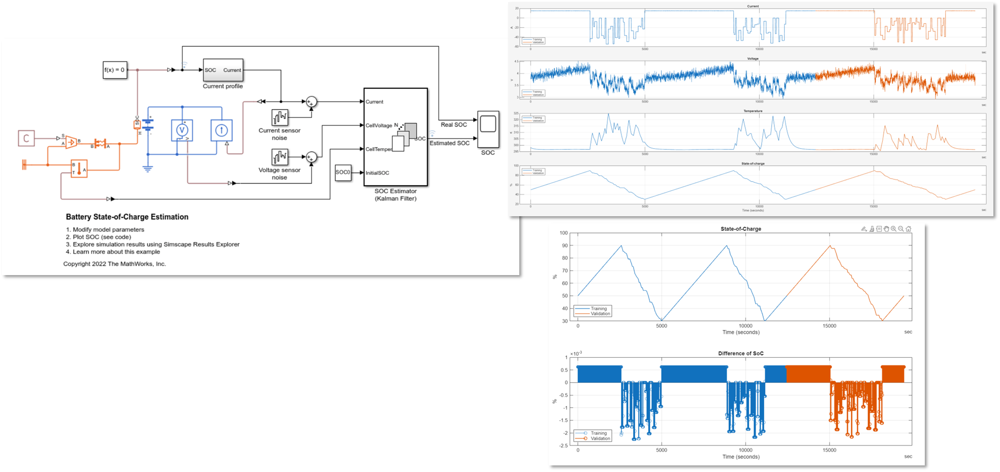
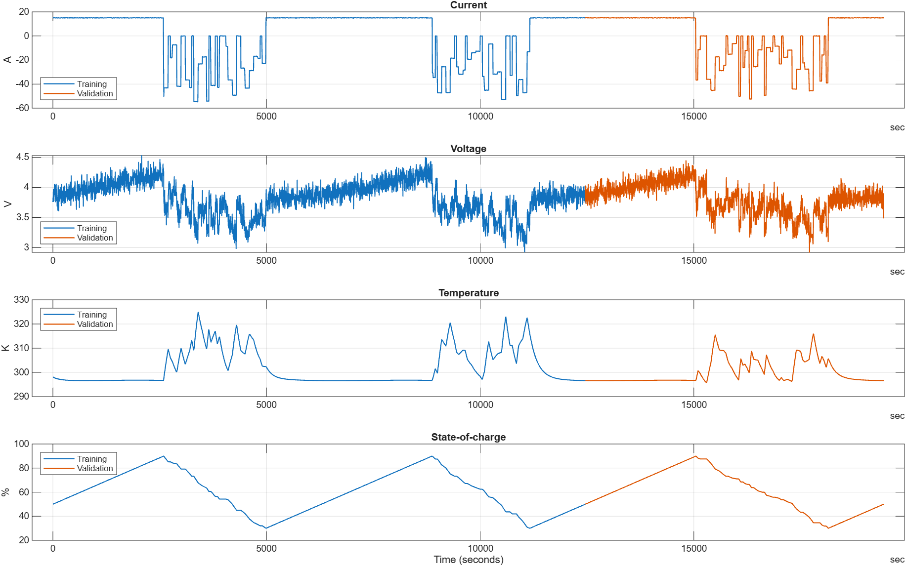
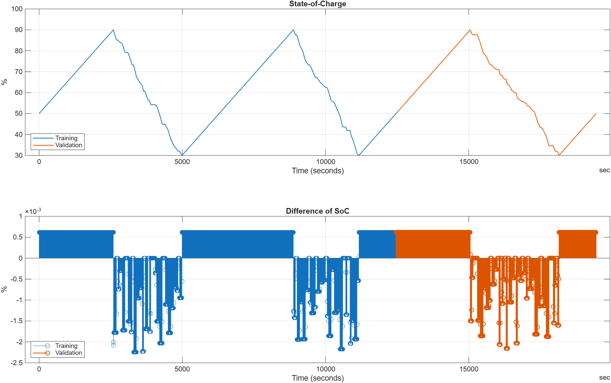
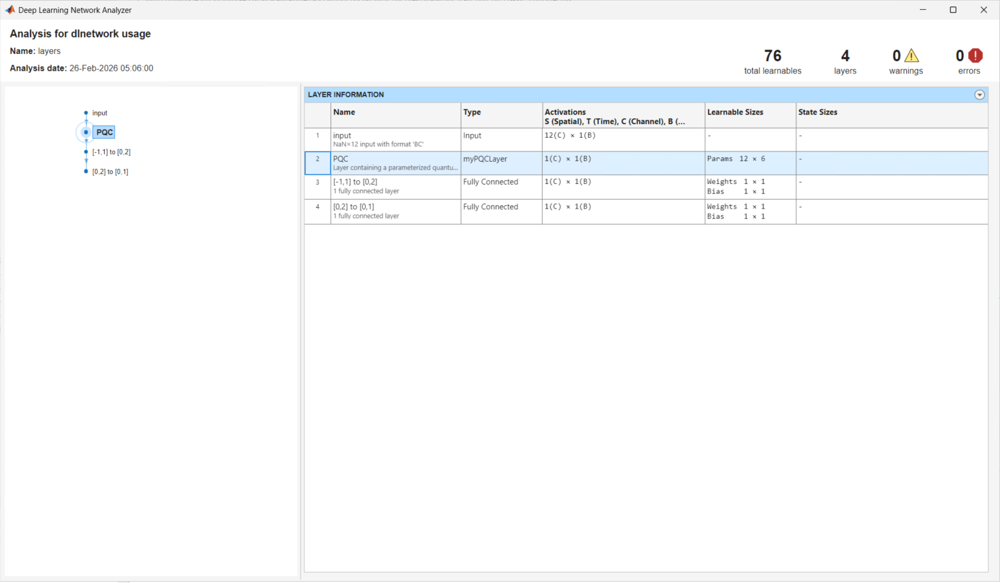
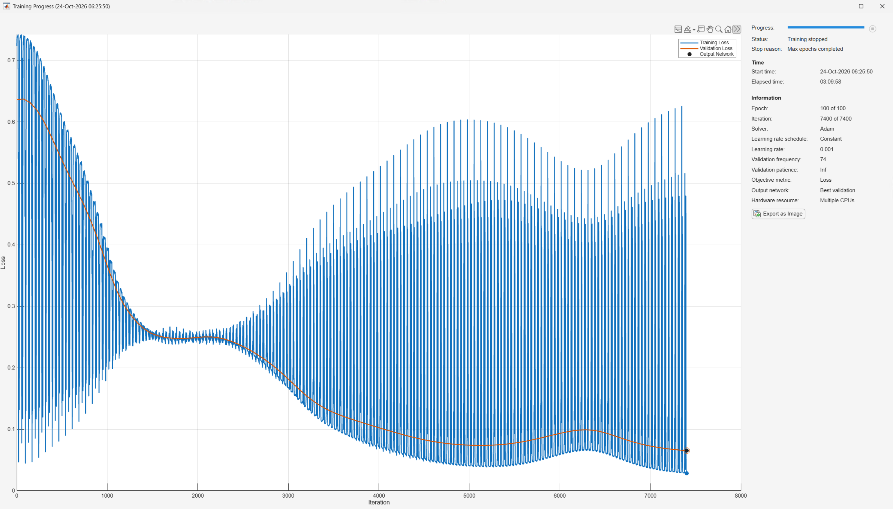
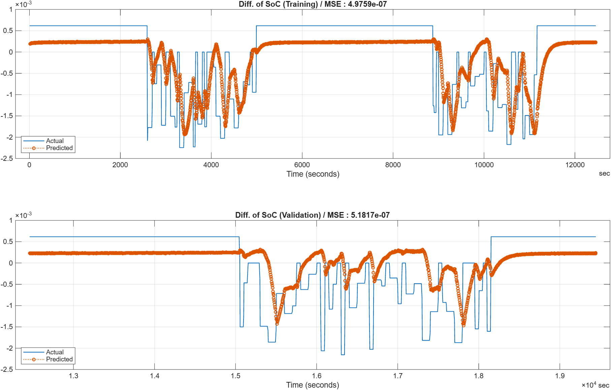
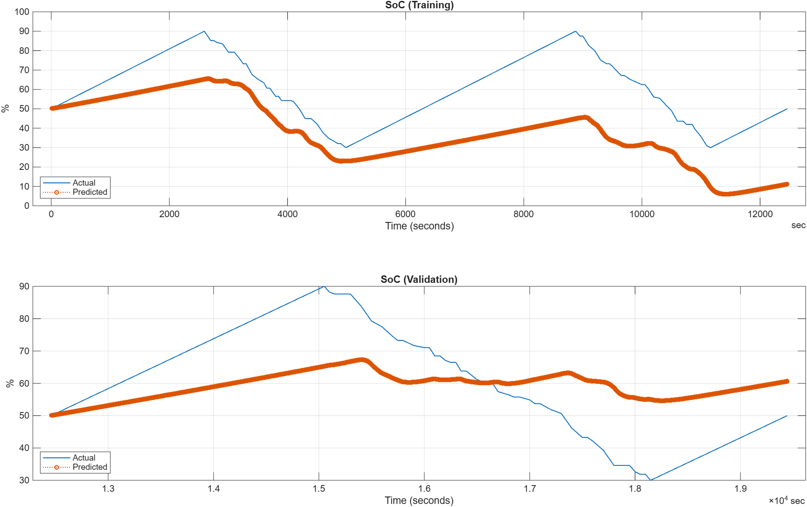

# Time series regression analysis to estimate state\-of\-charge using Quantum Neural Network

This script (script_train_dsoc_qnn_model_on_classic_computer.mlx) creates a model to estimate state of charge (SoC, remaining ratio of battery) from current, voltage and temperature 
using a quantum neural network (QNN) composed by quantum gates offered by [MATLAB&reg; Support Package for Quantum Computing](https://www.mathworks.com/matlabcentral/fileexchange/125425-matlab-support-package-for-quantum-computing).
The QNN appears in this script originates from reference [\[1\]](#PaperTimeSerires). This script requires the Deep Learning Toolbox&trade;, 
Statistics and Machine Learning Toolbox&trade;, Parallel Computing Toolbox&trade;, and the above support package in addition to MATLAB.
 
To check if the required toolboxes are installed, run `ver` on MATLAB command window.
To check if the required support package is installed, run the following command.

```matlab
matlabshared.supportpkg.getInstalled
```

```matlabTextOutput
                    Name                     Version Base Product
-------------------------------------------- ------- ------------
MATLAB Support Package for Quantum Computing 26.1.5
```

In addition, the `myPQCLayer` class and the `createPQC` function must be on MATLAB search path 
because the QNN invokes a quantum circuit called to Parameterized Quantum Circuit (PQC) as a custom layer.

```matlab
which myPQCLayer
```

```matlabTextOutput
<a directory>\myPQCLayer.m  % myPQCLayer constructor
```

By setting `isTrain` to `false`, this script is going to skip train the quantum neural network and run inference with the pre-trained network model.
When you set `isTrain = true` and run this script including its training, it could take more than 3 hours even if you run in parallel on 48 vCPUs.

```matlab
isTrain = false; %#ok<*UNRCH>
```

## 1. Import data from MAT-file and prepare data partition
### 1-1. Introduce data source 

The data in this script was acquired from one of the examples provided by Simscape Battery&trade;, [Battery State\-of\-Charge Estimation](https://www.mathworks.com/help/simscape-battery/ug/battery-state-of-charge-estimation.html).
This data consists of current, voltage, temperature, and SoC and had been downsampled to a frequency of 0.25 Hz.

<div align="center">
    
</div>

<div align="center">
    Fig.1. Simulink model BatterySOCEstimation.slx and graph of signals 
</div>

### 1-2. Import data from MAT-file

Import the timetable array as named `dataSocTT0` containing current, voltage, temperature and SoC from the SocDataset.mat in the current directory.

```matlab
matobjData = matfile("SocDataset.mat");
dataSocTT0 = matobjData.dataTT_All;
```

Display the top several rows of the timetable array `dataSocTT0` in the sake of checking its data type.

```matlab
head(dataSocTT0)
```

```matlabTextOutput
     Time     Current    Voltage    Temperature    SoC (Act)
    ______    _______    _______    ___________    _________

    0 sec     14.921     3.7585       298.15            50  
    4 sec     14.921     3.7626        298.1        50.062  
    8 sec      15.02     3.8642       298.06        50.123  
    12 sec    15.126     3.9732       298.02        50.185  
    16 sec    14.918     3.7672       297.97        50.247  
    20 sec    14.936     3.7877       297.93        50.309  
    24 sec    14.924     3.7774       297.89         50.37  
    28 sec    15.012     3.8669       297.86        50.432  
```


Define `dT` for sampling time.

```matlab
dT = seconds(diff(dataSocTT0.Time(1:2)));
```

### 1-3. Prepare to divide data into training and validation

We obtain the row numbers to extract data for training (0 ~ 3 h 27 m 40 s) and for validation (3 h 27 m 40 s ~ 5 h 24 m 4 s).
Here, validation data is not used to train the QNN model directly but is used to evaluate estimation error such as mean squared error (MSE) during training. 
In fact, the model with parameters, which minimize the estimation error for the validation data, will be adopted as the final result of training. 

```matlab
idxTrainEnd = find(dataSocTT0.Time == duration(3, 27, 40, 0, Format="s"));
idxValidEnd = find(dataSocTT0.Time == duration(5, 24, 4, 0, Format="s"));
```

Extract the necessary data only corresponding to training or validation period and define it as `dataSocTT`.

```matlab
dataSocTT = dataSocTT0(1:idxValidEnd,:);
numInputSignal = width(dataSocTT) - 1; % current, voltage, temperature
```
## 2. Data visualization 
### 2-1. Visualize imported 4 signals

Let's plot imported current, voltage, temperature and SoC with color-coded according to training and validation period.

```matlab
figure(Name = "Plot imported signals", NumberTitle = "off")
tiledlayout(4,1)

axH01 = nexttile;
plot(dataSocTT.Time(1:idxTrainEnd), dataSocTT.Current(1:idxTrainEnd), LineWidth = 1)
hold("on")
plot(dataSocTT.Time(idxTrainEnd:end), dataSocTT.Current(idxTrainEnd:end), LineWidth = 1)
title("Current")
ylabel("A")
grid("on")
hold("off")
legend(["Training", "Validation"], Location = "southwest")

axH02 = nexttile;
plot(dataSocTT.Time(1:idxTrainEnd), dataSocTT.Voltage(1:idxTrainEnd), LineWidth = 1)
hold("on")
plot(dataSocTT.Time(idxTrainEnd:end), dataSocTT.Voltage(idxTrainEnd:end), LineWidth = 1)
title("Voltage")
ylabel("V")
grid("on")
hold("off")
legend(["Training", "Validation"], Location = "southwest")

axH03 = nexttile;
plot(dataSocTT.Time(1:idxTrainEnd), dataSocTT.Temperature(1:idxTrainEnd), LineWidth = 1)
hold("on")
plot(dataSocTT.Time(idxTrainEnd:end), dataSocTT.Temperature(idxTrainEnd:end), LineWidth = 1)
title("Temperature")
ylabel("K")
grid("on")
hold("off")
legend(["Training", "Validation"], Location = "northwest")

axH04 = nexttile;
plot(dataSocTT.Time(1:idxTrainEnd), dataSocTT.("SoC (Act)")(1:idxTrainEnd), LineWidth = 1)
hold("on")
plot(dataSocTT.Time(idxTrainEnd:end), dataSocTT.("SoC (Act)")(idxTrainEnd:end), LineWidth = 1)
title('State-of-charge')
ylabel('%')
xlabel('Time (seconds)')
grid("on")
hold("off")
legend(["Training", "Validation"], Location = "northwest")

linkaxes([axH01, axH02, axH03, axH04], "x");
```

<div align="center">
    
</div>

<div align="center">
    Fig.2 Plot imported signals with color-coded according to training and verification period
</div>

### 2-2. Visualize SoC and $\Delta$SoC

Next, let's compute time differences of SoC ($\Delta {\textrm{SoC}} ={\textrm{SoC}}_t -{\textrm{SoC}}_{t-1}$) and then 
visualize SoC and $\Delta$SoC

```matlab
socDiffTable = diff(0.01.*dataSocTT(:,"SoC (Act)"));
socDiffTable.Time = socDiffTable.Time + seconds(dT);
socDiffTable = [timetable(NaN, RowTimes = seconds(0), VariableNames = "SoC (Act)"); socDiffTable];
socDiffTable.Properties.VariableNames(1) = "dSoC";

figure; tiledlayout(2,1);
axH11 = nexttile;
plot(axH11, dataSocTT.Time(1:idxTrainEnd), dataSocTT.("SoC (Act)")(1:idxTrainEnd), LineWidth = 1)
hold(axH11, "on")
plot(axH11, dataSocTT.Time(idxTrainEnd:end), dataSocTT.("SoC (Act)")(idxTrainEnd:end), LineWidth = 1)
title('State-of-Charge')
ylabel('%')
xlabel('Time (seconds)')
grid("on")
hold(axH11, "off")
legend(axH11, ["Training", "Validation"], Location = "southwest")

axH12 = nexttile;
stem(axH12, socDiffTable.Time(1:idxTrainEnd), socDiffTable.dSoC(1:idxTrainEnd))
hold(axH12, "on")
stem(axH12, socDiffTable.Time(idxTrainEnd:end), socDiffTable.dSoC(idxTrainEnd:end), LineWidth = 1)
title(axH12, 'Difference of SoC')
ylabel(axH12, '%')
xlabel(axH12, 'Time (seconds)')
grid(axH12, "on")
hold(axH12, "off")
legend(axH12, ["Training", "Validation"], Location = "southwest")

linkaxes([axH11, axH12], "x");
```

<div align="center">
    
</div>

<div align="center">
    Fig.3 Plot SoC and ΔSoC with color-coded according to training and verification period
</div>


## 3. Process data for training and validation
### 3-1. Calculate parameters to standardize data

When addressing machine learning, normalization and standardization are considered a standard task as data pre-processing 
because the data range difference could be reflected in weights of predictors.
To unify scale of the data, this script obtains offset value and scaling factor to suppress all signals to the range of $[0,1]$.
 
```matlab
[~, OffsetsInSig, ScaleFactorsInSig] = normalize(dataSocTT(:,1:numInputSignal), range = [0,1]);
```

### 3-2. Generate timetable array for regression model creation

This script creates a regression model $\varphi$ not to estimate SoC directly but to estimate $\Delta \textrm{SoC}$ taking into account of until 3th order delay of current, voltage and temperature.

 $$ \widehat{{\Delta \textrm{SoC}}_t } =\varphi \left({\textrm{Current}}_t ,{\textrm{Current}}_{t-1} ,{\textrm{Current}}_{t-2} ,{\textrm{Current}}_{t-3} ,{\textrm{Voltage}}_t ,{\textrm{Voltage}}_{t-1} ,{\textrm{Voltage}}_{t-2} ,{\textrm{Voltage}}_{t-3} ,{\textrm{Temperature}}_t ,{\textrm{Temperature}}_{t-1} ,{\textrm{Temperature}}_{t-2} ,{\textrm{Temperature}}_{t-3} \right) $$ 

Therefore, we generate a timetable `xDataAll` corresponding to the predictor of $\varphi$ at first before data standardization.

```matlab
LagOrder     = 3;
xDataAll = array2timetable(nan(height(dataSocTT), numInputSignal*(1+LagOrder)), RowTimes = dataSocTT.Time, ...
    VariableNames = reshape(transpose([transpose(string(dataSocTT.Properties.VariableNames(1:numInputSignal))) + "(t)", ...
                            transpose(string(dataSocTT.Properties.VariableNames(1:numInputSignal))) + "(t-1)", ...
                            transpose(string(dataSocTT.Properties.VariableNames(1:numInputSignal))) + "(t-2)", ...
                            transpose(string(dataSocTT.Properties.VariableNames(1:numInputSignal))) + "(t-3)"]),1,(1+LagOrder)*numInputSignal));

xDataAll.("Current(t)") = dataSocTT.Current;
xDataAll.("Current(t-1)")(2:end) = dataSocTT.Current(1:end-1);
xDataAll.("Current(t-2)")(3:end) = dataSocTT.Current(1:end-2);
xDataAll.("Current(t-3)")(4:end) = dataSocTT.Current(1:end-3);

xDataAll.("Voltage(t)") = dataSocTT.Voltage;
xDataAll.("Voltage(t-1)")(2:end) = dataSocTT.Voltage(1:end-1);
xDataAll.("Voltage(t-2)")(3:end) = dataSocTT.Voltage(1:end-2);
xDataAll.("Voltage(t-3)")(4:end) = dataSocTT.Voltage(1:end-3);

xDataAll.("Temperature(t)") = dataSocTT.Temperature;
xDataAll.("Temperature(t-1)")(2:end) = dataSocTT.Temperature(1:end-1);
xDataAll.("Temperature(t-2)")(3:end) = dataSocTT.Temperature(1:end-2);
xDataAll.("Temperature(t-3)")(4:end) = dataSocTT.Temperature(1:end-3);
```

Difine `xDataAllN` which is standardized from `xDataAll` and is actual predictor dataset of $\varphi$.

```matlab
xDataAllN = xDataAll;
xDataAllN{:,1:1+LagOrder} = (xDataAll{:,1:1+LagOrder} - OffsetsInSig.Current) ./ ScaleFactorsInSig.Current;
xDataAllN{:,1+1+LagOrder:2*(1+LagOrder)} = (xDataAll{:,1+1+LagOrder:2*(1+LagOrder)} - OffsetsInSig.Voltage) ./ ScaleFactorsInSig.Voltage;
xDataAllN{:,1+2*(1+LagOrder):3*(1+LagOrder)} = (xDataAll{:,1+2*(1+LagOrder):3*(1+LagOrder)} - OffsetsInSig.Temperature) ./ ScaleFactorsInSig.Temperature;
```

We don't need to generate the response dataset of $\varphi$ because it was defined as `socDiffTable` in advance.

### 3-3. Partition into training and validation

Define `xDataTrain` and `yDataTrain` as predictor and response data for training respectively.

```matlab
xDataTrain   = xDataAllN{1+LagOrder:idxTrainEnd, :};
numTrainData = size(xDataTrain,1);
yDataTrain = socDiffTable.dSoC(1+LagOrder:idxTrainEnd);
```

Define `xDataValid` and `yDataValid` as predictor and response data for validation respectively, too.

```matlab
xDataValid   = xDataAllN{idxTrainEnd:end, :};
numValidData = size(xDataValid,1);
yDataValid = socDiffTable.dSoC(idxTrainEnd:end);
```
## 4. Create quantum neural network as prediction model

Create the quantum neural network according to the number of predictors using 
a Parameterized Quantum Circuit (PQC) based on reference [\[1\]](#PaperTimeSerires).

```matlab
layers = [inputLayer([NaN, size(xDataTrain,2)], "BC"); ...
    myPQCLayer; ...
    fullyConnectedLayer(1, Name = "[-1,1] to [0,2]", Weights = 1, Bias = 1, WeightLearnRateFactor = 0, BiasLearnRateFactor = 0); ...
    fullyConnectedLayer(1, Name = "[0,2] to [0,1]", Weights = 0.5, Bias = 0, WeightLearnRateFactor = 0, BiasLearnRateFactor = 0) ...
    ];
```
Here the `inputLayer` requires the input size of the network model as the 1st input argument and its data format as the 2nd input argument.
The "BC" of the 2nd input argument indicates that the network expects to evaluate a matrix whose row corresponds to "(Mini-)Batch" and whose column corresponds to "Channel".
The "C(hannel)" is a synonym of predictor in the machine learning world so the number of channel is same to the `size(xDataTrain,2)`.
On the other hand, the `inputLayer` is not required to fix the mini-batch size at this time, so `NaN` is specified as the row number of input of the QNN model.
The range of response from the regression model must be [0,1] because of standardized $\Delta \textrm{SoC}$, however, the range value of the myPQCLayer is [−1,1].
Therefore, we adjust the output of the myPQCLayer using 2 fully-connected layers.
The `WeightLearnRateFactor` and the `BiasLearnRateFactor` are set to 0 because these parameters are not be trained.

Let's check the consistency of each layer in the create network using the Deep Learning Network Analyzer.

```matlab
analyzeNetwork(layers)
```
<div align="center">
    
</div>

<div align="center">
    Fig.4 Deep Learning Network Analyzer
</div>


## 5. Set up before training the QNN model
### 5-1. Find the optimal mini-batch size depending on training environment

Training network model takes long time generally, so parallel computing is standard approach to get speeding up this expensive process.
In addition, it's more effective to parallelize on CPUs rather than on GPU in this case.
There is a property named `ExecutionEnvironment` as one of the training options offered by Deep Learning Toolbox,
setting it to `parallel-cpu` enables parallel training on multiple CPU cores.

Besides, there is another property named `MiniBatchSize` in the training options and the number of training tasks running simultaneously is equal to
this value. Therefore, you should find the appropriate `MiniBatchSize` taking into account of the training data size `numTrainData` depending on your training environment.


```matlab
for n = 0:7
    disp("####### n = " + string(n) + " #######")
    disp(factor(numTrainData-n)); % run prime factorization
    disp(newline)
end
```

```matlabTextOutput
####### n = 0 #######
    11   283
####### n = 1 #######
     2     2     2   389
####### n = 2 #######
     3    17    61
####### n = 3 #######
     2     5   311
####### n = 4 #######
        3109
####### n = 5 #######
     2     2     3     7    37
####### n = 6 #######
    13   239
####### n = 7 #######
           2        1553
```

As the result of the above prime number factorization, in case of a training environment equipped 48 vCPUs, 
it seems the best to set the `MiniBatchSize` to $42 = 2 \times 3 \times 7$ displayed as the output of `factor(numTrainData-5)` 
and run training with $74 = 2 \times 37$ iterations per epoch. 

```matlab
miniBatchSize = 42;
iterPerEpoch = floor(numTrainData/miniBatchSize); 
```

- Modify the value of `miniBatchSize` to appropriate value depending on the number of CPU cores on your environment.
- Change the maximum number of `n` if you cannot find appropriate `miniBatchSize` value according to your environment.

### 5-2. Launch MATLAB workers to run training in parallel

Launch MATLAB worker processes for parallel computing

```matlab
if isTrain
    poolObj = parpool(miniBatchSize);
end    
```
```matlabTextOutput
Starting parallel pool (parpool) using the 'Processes' profile ...
Connected to parallel pool with 42 workers.
```

- See this [FAQ page](https://www.mathworks.com/matlabcentral/answers/1594159-how-many-workers-can-i-use-in-parallelization), if you cannot launch the specified number of workers i.e. `miniBatchSize` even though that is less than or equal to the number of vCPU recognized by your operating system.

### 5-3. Set the training options

In addition to the `MiniBatchSize` we found in the section 5-1, let's set training options such as `MaxEpochs` to terminate the training and 
`Plots` for monitoring its progress, and specify validation data to evaluate estimation error.

```matlab
options = trainingOptions("adam", ...
    ExecutionEnvironment = "parallel-cpu", ...
    MaxEpochs = 100, ...
    MiniBatchSize = miniBatchSize, ...
    InitialLearnRate = 1e-3, ...
    Shuffle = "never", ...
    Plots = "training-progress", ...
    ValidationData = {xDataValid, yDataValid}, ...
    ValidationFrequency = iterPerEpoch, ...
    Verbose = false);
```

## 6. Train the QNN model

As you can see in the attached the image at the bottom of this chaper exported from the Training Progress Monitor, the training takes pretty long time.
Even when we try the training using 48 vCPUs, it took more than 20 hours. 
Hence, if you set the `isTrain` to `false`, this script enables to skip running the expensive network training
and allows to proceed the subsequent processing by loading the pre-trainined QNN model.

```matlab
if isTrain
    % Train the deep learning network
    net = trainnet(xDataTrain, yDataTrain, layers, "mse", options);
        save SocDiff3Lag100EpochsTrainedNetwork net options layers xDataTrain xDataValid yDataTrain yDataValid
else
    matobjTrainedNet = matfile("SocDiff3Lag100EpochsTrainedNetwork");
    net = matobjTrainedNet.net;
end
```

<div align="center">
    
</div>	
<div align="center">	
    Fig.5 Appearance of Training Progress Monitor After 100 Epochs
</div>


## 7. Infer ΔSoC using the trained QNN model

Run inference using the trained QNN `net` for training and validation data and then evaluate its inference error.

### 7-1. Calculate parameters for scaling the output of the QNN to original range

The output from the trained QNN is between 0 and 1, so we calculate the parameters needed to convert to the original $\Delta \textrm{SoC}$ scale.

```matlab
ScaleFactorYn = max(socDiffTable.dSoC) - min(socDiffTable.dSoC);
OffsetYn = min(socDiffTable.dSoC);
```

### 7-2. Infer for training data

Re-scale after inferring for training data and then evaluating its error using MSE.

```matlab
tic; yHat0 = predict(net,xDataTrain); toc
```

```matlabTextOutput
Elapsed time is 15.841061 seconds.
```

```matlab
MseTrain = sum(((ScaleFactorYn*yHat0 + OffsetYn)  - yDataTrain).^2) ./ numel(yDataTrain);
disp("MSE (Training): " + string(MseTrain))
```

```matlabTextOutput
MSE (Training): 4.9759e-07
```

### 7-3. Infer for validation data

Run the same computation for the validation data

```matlab
tic; yHatV = predict(net,xDataValid); toc
```

```matlabTextOutput
Elapsed time is 11.543285 seconds.
```

```matlab
MseValid = sum(((ScaleFactorYn*yHatV + OffsetYn)  - yDataValid).^2) ./ numel(yDataValid);
disp("MSE (Validation): " + string(MseValid))
```

```matlabTextOutput
MSE (Validation): 5.1817e-07
```

## 8. Visualize the results of inference and their ground truth
### 8-1. Visualize actual and inferred ΔSoC

Plot estimated $\Delta \textrm{SoC}$ values by using red dotted line with marker and plot their ground truth by using blue line in the upper axis, 
and then plot the same kind of graphs for the validation data in the lower axis.
 
```matlab
figure(Name = "Plot predicted difference of SoC vs. its groud truth", NumberTitle = "off")
tiledlayout(2,1)

axH21 = nexttile;
plot(axH21, socDiffTable.Time(1:idxTrainEnd), socDiffTable.dSoC(1:idxTrainEnd), LineWidth = 1)
hold(axH21, "on")
plot(axH21, socDiffTable.Time(1+LagOrder:idxTrainEnd), ScaleFactorYn*yHat0 + OffsetYn, LineWidth = 1, LineStyle = ":", Marker = "o" ,MarkerSize = 4)
title(axH21, "Diff. of SoC (Training) / MSE : " + string(MseTrain))
xlabel(axH21, 'Time (seconds)')
legend(axH21, ["Actual", "Predicted"], Location = "southwest");
grid(axH21, "on")
hold(axH21, "off")

axH22 = nexttile;
plot(axH22, socDiffTable.Time(idxTrainEnd:end), socDiffTable.dSoC(idxTrainEnd:end), LineWidth = 1)
hold(axH22, "on")
plot(axH22, socDiffTable.Time(idxTrainEnd:end), ScaleFactorYn*yHatV + OffsetYn, LineWidth = 1, LineStyle = ":", Marker = "o",MarkerSize = 4)
title(axH22, "Diff. of SoC (Validation) / MSE : " + string(MseValid))
xlabel(axH22, 'Time (seconds)')
legend(axH22, ["Actual", "Predicted"], Location = "southwest");
grid(axH22, "on")
hold(axH22, "off")
```

<div align="center">
    
</div>	
<div align="center">	
    Fig.6 Compare actual and estimated ΔSoC
</div>

### 8-2. Visualize actual and inferred SoC

Next, we estimate the SoC based on the cumulative sum of the estimated $\Delta \textrm{SoC}$ and plot graphs similar to the figure in the section 8-1.
We adopt the SoC value at 8 seconds as its initial value for training data 
and adopt the SoC value at 12460 seconds as its initial value for validation data. 

```matlab
figure(Name = "Plot predicted SoC vs. its groud truth", NumberTitle = "off")
tiledlayout(2,1)

axH31 = nexttile;
plot(axH31, dataSocTT.Time(1:idxTrainEnd), dataSocTT.("SoC (Act)")(1:idxTrainEnd), LineWidth = 1)
hold(axH31, "on")
plot(axH31, dataSocTT.Time(LagOrder:idxTrainEnd), dataSocTT.("SoC (Act)")(LagOrder) + [0; 100*cumsum(ScaleFactorYn*yHat0 + OffsetYn)], ...
    LineWidth = 1, LineStyle = ":", Marker = "o" ,MarkerSize = 4)
title(axH31, "SoC (Training)")
xlabel(axH31, 'Time (seconds)')
ylabel(axH31, "%")
legend(axH31, ["Actual", "Predicted"], Location = "southwest");
grid(axH31, "on")
hold(axH31, "off")

axH32 = nexttile;
plot(axH32, dataSocTT.Time(idxTrainEnd:end), dataSocTT.("SoC (Act)")(idxTrainEnd:end), LineWidth = 1)
hold(axH32, "on")
plot(axH32, dataSocTT.Time(idxTrainEnd:end), + dataSocTT.("SoC (Act)")(idxTrainEnd) + 100 * cumsum(ScaleFactorYn*yHatV + OffsetYn), ...
    LineWidth = 1, LineStyle = ":", Marker = "o",MarkerSize = 4)
title(axH32, "SoC (Validation)")
xlabel(axH32, 'Time (seconds)')
ylabel(axH32, "%")
legend(axH32, ["Actual", "Predicted"], Location = "southwest");
grid(axH32, "on")
hold(axH32, "off")
```

<div align="center">
    
</div>	
<div align="center">	
    Fig.7 Compare actual and estimated SoC, which is constructed from the cumulative sum of the estimated ΔSoC
</div>


We can see that the estimated SoC has lost touch with its ground truth as time progresses, 
in particular when we take a look at the lower axis about validation data. 
It implies that we should perform calibration at a certain interval regularly in actual operation.

## 9. Post-processing
### 9.1 Shutdown MATLAB workers

Terminate the MATLAB workers that were launched for accelerating network training

```matlab
if isTrain
    delete(poolObj); % Clean up parallel pool if it was created
end
```

```matlabTextOutput
Parallel pool using the 'Processes' profile is shutting down.
```

### 9.2 \[Option\] Save all variables in the workspace if necessary

```matlab
isSaveAllVars = false;

if isSaveAllVars
    save AllWorkspaceVariablesSoCDiff100Epochs
end
```

## Reference
<a id="PaperTimeSerires">1</a>. Dimitrios Emmanoulopoulos and Sofija Dimoska. "[Quantum Machine Learning in Finance: Time Series Forecasting](https://arxiv.org/abs/2202.00599)" (2022) 
