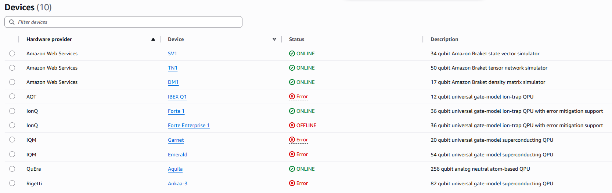
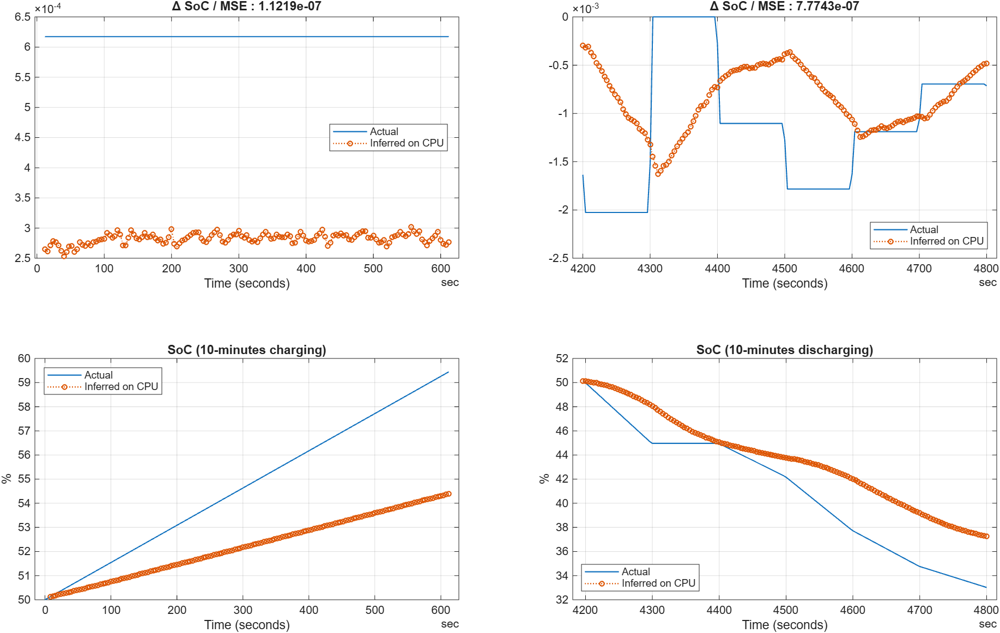
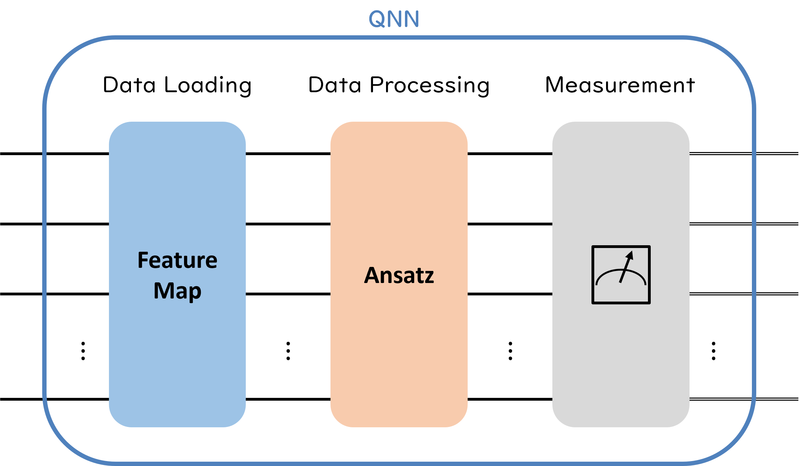
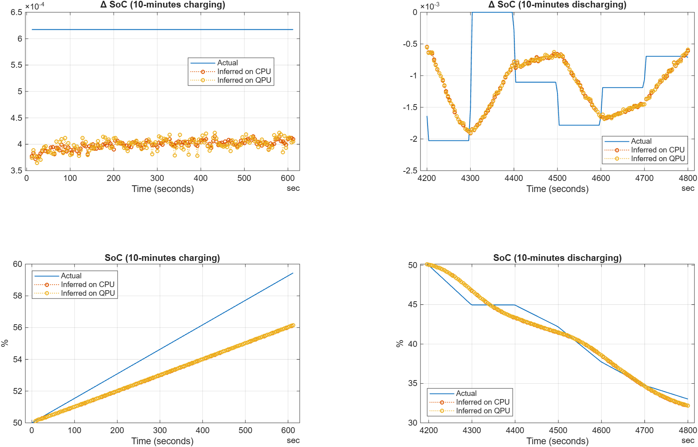

# Run inference using a trained quantum neural network on QPU device

This script (script_infer_dsoc_on_aws_braket.mlx) introduces how to run inference using a pre-trained quantum neural network (QNN)
on QPU device provided by Amazon&reg; Web Services (AWS&reg;), providing quantum computing service, as part of time series analysis.
Regarding the pre-trained QNN model, this script is going to use the network 
which had been trained to estimate $\Delta \textrm{SoC}$ (time difference State of Charge) in the other script
(BatterySoC/Create_and_TrainModel/script_train_dsoc_qnn_model_on_classic_computer.mlx).

## Before you run this script
<!--## 1. Requirements & Tips -->

### A. Requirements for your host to submit tasks to Amazon Braket

This script requires the Deep Learning Toolbox&trade;, Statistics and Machine Learning Toolbox&trade;, 
and the [MATLAB&reg; Support Package for Quantum Computing](https://www.mathworks.com/matlabcentral/fileexchange/125425-matlab-support-package-for-quantum-computing) in addition to MATLAB.
To check if the required toolboxes are installed, run `ver` on MATLAB command window.
Run the following command to check if the required support package is installed.

```matlab
matlabshared.supportpkg.getInstalled
```

```matlabTextOutput
                    Name                     Version Base Product
-------------------------------------------- ------- ------------
MATLAB Support Package for Quantum Computing 26.1.5
```

In addition, the `myPQCLayer` class and the `createPQC` function must be on MATLAB search path because 
the trained QNN invokes a quantum circuit called to Parameterized Quantum Circuit (PQC) as a custom layer.

```matlab
which myPQCLayer
```

```matlabTextOutput
<a directory>\myPQCLayer.m  % myPQCLayer constructor
```

### B. Requirements on Amazon Web Service

#### i. Amazon Braket

It's strongly recommended to check whether a quantum device is available on the Amazon Console in advance 
because Amazon Braket is a shared computing resource. 
In particular, actual QPU devices are sometimes reserved by other users or might be offline status due to hardware maintenance.  

<div align="center">
    
</div>	
<div align="center">	
    Fig.1 Example of Quantum Hardware Statuses provided by Amazon Braket
</div>

**Notes: This support package requires QPU device which supports OpenQASM (Open Quantum Assembly Language). 
Therefore the Aquila from QuEra enabling to run AHS (Analog Hamiltonian Simulation) natively is unsupported.** 

#### ii. Amazon S3

When you use Amazon Braket, you need to set up a folder in your bucket provided by Amazon S3&trade; as a remote storage in advance.
Because the output from device of Amazon Braket exported to the folder in your S3 bucket as a JSON file. 
Please note that it's required to begin with **amazon\-braket\-** as the name of your bucket to store Amazon Braket outputs. 
For instance, when we assume that we create the folder `my-test-bucket` in the `amazon-braket-mathworks` bucket, 
specify its path as follows:  

```matlab
S3URI  = "s3://amazon-braket-mathworks/my-test-bucket";
```

**Notes: Please change the above `S3URI` appropriately depending on yours.**


On the MATLAB side, before submitting a task to Amazon Braket, it's required to set the following environment variables 
on MATLAB using [`setenv`](https://www.mathworks.com/help/matlab/ref/setenv.html). 

-  `AWS_DEFAULT_REGION` 
-  `AWS_ACCESS_KEY_ID` 
-  `AWS_SECRET_ACCESS_KEY` 
-  `AWS_SESSION_TOKEN (option)` 

See below pages for details regarding S3 access

[Work with Remote Data](https://www.mathworks.com/help/matlab/import_export/work-with-remote-data.html)<br>
[Work with Deep Learning Data in AWS](https://www.mathworks.com/help/deeplearning/ug/work-with-deep-learning-data-in-aws.html)

## 2. Import data and preprocess as preparing ΔSoC inference

### 2-1. Import data from the MAT-file
Import a timetable containing current, voltage, temperature and SoC data sampled every 4 seconds 
from the `SocDataset.mat` in the current folder.  This data was acquired from one of the example 
provided by Simscape Battery&trade;, 
[Battery State\-of\-Charge Estimation](https://www.mathworks.com/help/simscape-battery/ug/battery-state-of-charge-estimation.html) 
and was downsampled to 0.25 Hz.

```matlab
matobjData = matfile("SocDataset.mat");
dataSocTT0 = matobjData.dataTT_All;
dT = seconds(diff(dataSocTT0.Time(1:2))); % Sampling Time
numInputSignal = width(dataSocTT0) - 1; % Number of Input Signals
```

Align the height of `dataSocTT0` to match the length of data when the QNN model was trained.

```matlab
idxValidEnd = find(dataSocTT0.Time == duration(5, 24, 4, 0, Format="s")); % extract until 5H 24M 4S
dataSocTT = dataSocTT0(1:idxValidEnd,:);
```

### 2-2. Prepare data corresponding to predictors

The QNN model to infer $\Delta \textrm{SoC}$ can be formulated out as follows:

 $$ \widehat{{\Delta \textrm{SoC}}_t } =\varphi \left({\textrm{Current}}_t ,{\textrm{Current}}_{t-1} ,{\textrm{Current}}_{t-2} ,{\textrm{Current}}_{t-3} ,{\textrm{Voltage}}_t ,{\textrm{Voltage}}_{t-1} ,{\textrm{Voltage}}_{t-2} ,{\textrm{Voltage}}_{t-3} ,{\textrm{Temperature}}_t ,{\textrm{Temperature}}_{t-1} ,{\textrm{Temperature}}_{t-2} ,{\textrm{Temperature}}_{t-3} \right) $$ 

Before generating a timetable `xDataAll` taking into account of the predictor corresponding to the input variables of the above formula, 
calculate the parameters for standardization in the same way as when we created the model $\varphi$.

```matlab
[~, OffsetsInSig, ScaleFactorsInSig] = normalize(dataSocTT(:,1:numInputSignal), range = [0,1]);
```

Let's generate the timetable `xDataAll` contained data before standardization.

```matlab
LagOrder     = 3;
xDataAll = array2timetable(nan(height(dataSocTT), numInputSignal*(1+LagOrder)), RowTimes = dataSocTT.Time, ...
    VariableNames = reshape(transpose([transpose(string(dataSocTT.Properties.VariableNames(1:numInputSignal))) + "(t)", ...
                            transpose(string(dataSocTT.Properties.VariableNames(1:numInputSignal))) + "(t-1)", ...
                            transpose(string(dataSocTT.Properties.VariableNames(1:numInputSignal))) + "(t-2)", ...
                            transpose(string(dataSocTT.Properties.VariableNames(1:numInputSignal))) + "(t-3)"]), 1,12));

% current data
xDataAll.("Current(t)") = dataSocTT.Current;
xDataAll.("Current(t-1)")(2:end) = dataSocTT.Current(1:end-1);
xDataAll.("Current(t-2)")(3:end) = dataSocTT.Current(1:end-2);
xDataAll.("Current(t-3)")(4:end) = dataSocTT.Current(1:end-3);

% voltage data
xDataAll.("Voltage(t)") = dataSocTT.Voltage;
xDataAll.("Voltage(t-1)")(2:end) = dataSocTT.Voltage(1:end-1);
xDataAll.("Voltage(t-2)")(3:end) = dataSocTT.Voltage(1:end-2);
xDataAll.("Voltage(t-3)")(4:end) = dataSocTT.Voltage(1:end-3);

% temperature data
xDataAll.("Temperature(t)") = dataSocTT.Temperature;
xDataAll.("Temperature(t-1)")(2:end) = dataSocTT.Temperature(1:end-1);
xDataAll.("Temperature(t-2)")(3:end) = dataSocTT.Temperature(1:end-2);
xDataAll.("Temperature(t-3)")(4:end) = dataSocTT.Temperature(1:end-3);
```

Define `xDataAllN`, which is the actual predictor data, as the standardized output from `xDataAll`.

```matlab
xDataAllN = xDataAll;
xDataAllN{:,1:1+LagOrder} = (xDataAll{:,1:1+LagOrder} - OffsetsInSig.Current) ./ ScaleFactorsInSig.Current;
xDataAllN{:,1+1+LagOrder:2*(1+LagOrder)} = (xDataAll{:,1+1+LagOrder:2*(1+LagOrder)} - OffsetsInSig.Voltage) ./ ScaleFactorsInSig.Voltage;
xDataAllN{:,1+2*(1+LagOrder):3*(1+LagOrder)} = (xDataAll{:,1+2*(1+LagOrder):3*(1+LagOrder)} - OffsetsInSig.Temperature) ./ ScaleFactorsInSig.Temperature;
```

<a id="TMP_9076"></a>
### 2-3. Prepare data corresponding to response

Generate data equivalent to $\Delta \textrm{SoC}$ which corresponds to the output of the model $\varphi$.

```matlab
socDiffTable = diff(0.01.*dataSocTT(:,"SoC (Act)"));
socDiffTable.Time = socDiffTable.Time + seconds(dT);
socDiffTable = [timetable(NaN, RowTimes = seconds(0), VariableNames = "SoC (Act)"); socDiffTable];
socDiffTable.Properties.VariableNames(1) = "dSoC";
```

We don't need to standardize this response data but need to re-scale the output from the pre-trained QNN model. 
So we obtain its parameters for standardization.

```matlab
ScaleFactorYn = max(socDiffTable.dSoC) - min(socDiffTable.dSoC);
OffsetYn = min(socDiffTable.dSoC);
```

## 3. Import the pre-trained quantum neural network

Import the pre-trained QNN including a Parameterized Quantum Circuit (PQC) from the MAT-file `SocDiff3Lag100EpochsTrainedNetwork.mat`.

```matlab
matobjTrainedNet  = matfile("SocDiff3Lag100EpochsTrainedNetwork");
net = matobjTrainedNet.net;
```

Please note that the output of this pre-trained network is suppressed to within $\left\lbrack 0,1\right\rbrack$.
Therefore, we need to re-scale it to the original range of $\Delta \textrm{SoC}$ by using the standardization parameters, 
`ScaleFactorYn` and `OffsetYn`, calculated in the section [2-3 Prepare data corresponding to response](#TMP_9076).
 
## 4. Infer on your classical computer

We don't estimate over the periods of entire imported data, but focus on certain periods of 10 minutes charging and discharging.
Regarding to the 10 minutes charging period, it begins at 12 (= 0 + `dT*LagOder`) seconds and the SoC was 50% at the 0 seconds.
On the other hand, the 10 minutes discharging period, is starts from 4200 seconds when the SoC reached at approximately 50% again. 

```matlab
idxChargeS = 1 + LagOrder;
idxChargeE = find(xDataAllN.Time == duration(0, 10, dT*LagOrder, 0, Format="s"));

idxDischgS = find(xDataAllN.Time == duration(1, 10, 0, 0, Format="s")); % 4200s --> 1h : 10m : 00s
idxDischgE = idxDischgS + 10*60/dT;

yDataCharge = socDiffTable.dSoC(idxChargeS:idxChargeE);
yDataDischg = socDiffTable.dSoC(idxDischgS:idxDischgE);
```

Run inference for $\Delta \textrm{SoC}$ over the 10 minutes charging and discharging period on the classical computer 
and calculate the inference errors using  mean squared error (MSE) after re-scaling with the standardization parameters. 

```matlab
yHatChargeCls = predict(net,xDataAllN{idxChargeS:idxChargeE,:});
MseChargeCls = sum(((ScaleFactorYn*yHatChargeCls + OffsetYn)  - yDataCharge).^2) ./ numel(yDataCharge);
disp("MSE (10 min. charge status): " + string(MseChargeCls))
```

```matlabTextOutput
MSE (10 min. charge status): 1.1219e-07
```

```matlab
yHatDischgCls = predict(net,xDataAllN{idxDischgS:idxDischgE,:});
MseDischgCls = sum(((ScaleFactorYn*yHatDischgCls + OffsetYn)  - yDataDischg).^2) ./ numel(yDataDischg);
disp("MSE (10 min. discharge status): " + string(MseDischgCls))
```

```matlabTextOutput
MSE (10 min. discharge status): 7.7743e-07
```

<a id="M_2161"></a>
## 5. Visualize the results of inference on the classical computer and their ground truth

Let's plot the estimated $\Delta \textrm{SoC}$ values and SoC values, 
which are obtained as cumulative sum of $\Delta \textrm{SoC}$ based on each initial value of charging and discharging period respectively.

```matlab
figure; tiledlayout(2,2)

axH01 = nexttile;
plot(axH01, socDiffTable.Time(idxChargeS:idxChargeE), socDiffTable.dSoC(idxChargeS:idxChargeE), LineWidth = 1)
hold(axH01, "on")
plot(axH01, socDiffTable.Time(idxChargeS:idxChargeE), ScaleFactorYn*yHatChargeCls + OffsetYn, LineWidth = 1, LineStyle = ":", Marker = "o" ,MarkerSize = 4)
title(axH01, "\Delta SoC / MSE : " + string(MseChargeCls))
xlabel(axH01, 'Time (seconds)')
legend(axH01, ["Actual", "Inferred on CPU"], Location = "best");
grid(axH01, "on")
hold(axH01, "off")

axH02 = nexttile;
plot(axH02, socDiffTable.Time(idxDischgS:idxDischgE), socDiffTable.dSoC(idxDischgS:idxDischgE), LineWidth = 1)
hold(axH02, "on")
plot(axH02, socDiffTable.Time(idxDischgS:idxDischgE), ScaleFactorYn*yHatDischgCls + OffsetYn, LineWidth = 1, LineStyle = ":", Marker = "o",MarkerSize = 4)
title(axH02, "\Delta SoC / MSE : " + string(MseDischgCls))
xlabel(axH02, 'Time (seconds)')
legend(axH02, ["Actual", "Inferred on CPU"], Location = "southeast");
grid(axH02, "on")
hold(axH02, "off")

axH03 = nexttile;
plot(axH03, dataSocTT.Time(1:idxChargeE), dataSocTT.("SoC (Act)")(1:idxChargeE), LineWidth = 1)
hold(axH03, "on")
plot(axH03, dataSocTT.Time(LagOrder:idxChargeE), dataSocTT.("SoC (Act)")(LagOrder) + [0; 100*cumsum(ScaleFactorYn*yHatChargeCls + OffsetYn)], ...
    LineWidth = 1, LineStyle = ":", Marker = "o" ,MarkerSize = 4)
title(axH03, "SoC (10-minutes charging)")
xlabel(axH03, 'Time (seconds)')
ylabel(axH03, "%")
legend(axH03, ["Actual", "Inferred on CPU"], Location = "northwest");
grid(axH03, "on")
hold(axH03, "off")

axH04 = nexttile;
plot(axH04, dataSocTT.Time(idxDischgS-1:idxDischgE), dataSocTT.("SoC (Act)")(idxDischgS-1:idxDischgE), LineWidth = 1)
hold(axH04, "on")
plot(axH04, dataSocTT.Time(idxDischgS-1:idxDischgE), dataSocTT.("SoC (Act)")(idxDischgS-1) + [0; 100*cumsum(ScaleFactorYn*yHatDischgCls + OffsetYn)], ...
    LineWidth = 1, LineStyle = ":", Marker = "o" ,MarkerSize = 4)
title(axH04, "SoC (10-minutes discharging)")
xlabel(axH04, 'Time (seconds)')
ylabel(axH04, "%")
legend(axH04, ["Actual", "Inferred on CPU"], Location = "southwest");
grid(axH04, "on")
hold(axH04, "off")
```

<div align="center">
    
</div>	
<div align="center">	
    Fig.2 Inferred ΔSoC/SoC vs. their ground truth
</div>

There 4 axes in the above figure and blue lines are actual measured $\Delta \textrm{SoC}$ or SoC and red lines with circle marker are their inferred values on the classical computer.
The upper axes display 2 graphs about the actual and inferred $\Delta \textrm{SoC}$ values and 
the lower axes display 2 graphs about the actual and inferred SoC using cumulative sum of $\Delta \textrm{SoC}$ values. 
The left axes correspond to 10-minutes charging period and the right axes correspond to 10-minutes discharging period.


## 6. Infer on a QPU device in Amazon Braket

We have worked the SoC inference task on the classical computer until the chaper 5, but in the chapter 6, we're going to a quantum processing unit (QPU) provided by Amazon Braket. 
It's specified to use not a actual QPU device but a simulator in this script. 
If you want to submit your tasks to the actual QPU, define the variable to to its ARN identifier.


### 6-1. Select a QPU device on Amazon Braket

First, we need to select a QPU device from the [AWS console](https://console.aws.amazon.com/console/home).
The size of circuit, called parameterized quantum circuit (PQC), in the QNN model `net` to 
estimate $\Delta \textrm{SoC}$ is 13 qubits as follows:

```matlab
disp(1 + width(xDataAllN))
```

```matlabTextOutput
    13
```

Therefore, we select the `DM1` QPU simulator supporting quantum circuits with up to 17 qubits. 

```matlab
DeviceURI = "arn:aws:braket:::device/quantum-simulator/amazon/dm1";
QpuDevice = quantum.backend.QuantumDeviceAWS(DeviceURI, S3Path = S3URI, Region = "us-east-1");
```

*Notes : We are required to specify the `Region` property when we use a QPU simulator.*


### 6-2. Retrieve learnable parameters in the QNN model

Retrieve the learnable parameters in the PQC layer corresponding to the ansatz after 100 epochs training on the classical computer.

```matlab
trainedParams = net.Layers(2).Params;
```

<div align="center">
    
</div>	
<div align="center">	
    Fig.3 Architecture of General Quantum Neural Network
</div>


### 6-3. Define the observable object

Create an object corresponding to the measurement layer in the above figure.  

```matlab
obsPauli = observable([repmat('I',1,width(xDataAllN)),'Z'], 1);
```

### 6-4. Infer the ΔSoC values on the device of Amazon Braket

Let's run the inference for the 10-minutes charging period (equivalent to 151 tasks) on the quantum hardware provided by Amazon Braket. 

```matlab
yHatChargeQpu = nan(numel(yDataCharge),1);
cumElpTime = 0;

for nSmplCharge = 0:numel(yDataCharge)-1

    % create the parameterized quantum circuit to run on Amazon Braket
    qCircuit = createPQC(xDataAllN{idxChargeS+nSmplCharge,:}, trainedParams); % set the trained learnable parameters

    % Run the quantum circuit on the AWS simulator
    task = run(qCircuit, QpuDevice, Observable = obsPauli, NumShots = 10000);

    % wait for quantum task until it's finished
    sTime = tic;
    wait(task);
    eTime = toc(sTime);

    % retrieve the results of submitted quantum task
    results = fetchOutput(task);    

    % get the measured numeric expectation value
    yHatChargeQpu(1+nSmplCharge) = 0.5 * (1 + results);
    disp("Task # " + string(1+nSmplCharge) + " / " + string(numel(yDataCharge)) + " :: QPU Device (" ...
        + QpuDevice.Name + ")  : " + string(yHatChargeQpu(1+nSmplCharge)) + " / Classical Computer : " + string(yHatChargeCls(1+nSmplCharge)))

    % show the elapsed time for the current task
    disp("Elapsed time is " + string(eTime) + " seconds.")
    disp(newline)

    % update the cumulo-elapsed time for estimating dSoC for the charging period
    cumElpTime = eTime + cumElpTime;
end
```

```matlabTextOutput
Task # 1 / 151 :: QPU Device (dm1)  : 0.8702 / Classical Computer : 0.87593
Elapsed time is 6.0277 seconds.
Task # 2 / 151 :: QPU Device (dm1)  : 0.8718 / Classical Computer : 0.87531
Elapsed time is 6.7131 seconds.
Task # 3 / 151 :: QPU Device (dm1)  : 0.8733 / Classical Computer : 0.87601
Elapsed time is 6.0277 seconds.
    :
    :
Task # 151 / 151 :: QPU Device (dm1)  : 0.8864 / Classical Computer : 0.88782
Elapsed time is 9.544 seconds.
```

```matlab
disp("Elapsed time for " + string(numel(yDataCharge)) + " tasks during the charge status is " + string(cumElpTime) + " seconds.")
```

```matlabTextOutput
Elapsed time for 151 tasks during the charge status is 871.407 seconds.
```

Next, run the inference for the 10-minutes discharging period also.

```matlab
yHatDischgQpu = nan(numel(yDataDischg),1);
cumElpTime = 0;
for nSmplDischg = 0:numel(yDataDischg)-1

    % create the parameterized quantum circuit to run on the Amazon Braket
    qCircuit = createPQC(xDataAllN{idxDischgS+nSmplDischg,:}, trainedParams); % set the trained learnable parameters
    
    % Run the quantum circuit on the AWS simulator and fetch the results
    task = run(qCircuit, QpuDevice, Observable = obsPauli, NumShots = 10000);
    
    % wait for quantum task until it's finished
    sTime = tic;
    wait(task);
    eTime = toc(sTime);

    % retrieve the results of submitted quantum task
    results = fetchOutput(task);

    % get the measured numeric expectation value
    yHatDischgQpu(1+nSmplDischg) = 0.5 * (1 + results);
    disp("Task # " + string(1+nSmplDischg) + " / " + string(numel(yDataDischg)) + " :: QPU Device (" ... 
        +  QpuDevice.Name + ") : " + string(yHatDischgQpu(1+nSmplDischg)) + " / Classical Computer : " + string(yHatDischgCls(1+nSmplDischg)))
        
    % show the elapsed time for the current task
    disp("Elapsed time is " + string(eTime) + " seconds.")
    disp(newline)

    % update cumulo-elapsed time for estimating dSoC for the discharging period
    cumElpTime = eTime + cumElpTime;        
end
```

```matlabTextOutput
Task # 1 / 151 :: QPU Device (dm1) : 0.6002 / Classical Computer : 0.60349
Elapsed time is 7.884 seconds.
Task # 2 / 151 :: QPU Device (dm1) : 0.619 / Classical Computer : 0.62212
Elapsed time is 6.1433 seconds.
Task # 3 / 151 :: QPU Device (dm1) : 0.6177 / Classical Computer : 0.61849
Elapsed time is 6.2215 seconds.
    :
    :
Task # 151 / 151 :: QPU Device (dm1) : 0.5645 / Classical Computer : 0.56057
Elapsed time is 7.5865 seconds.
```

```matlab
disp("Elapsed time for " + string(numel(yDataDischg)) + " tasks during the discharge status is " + string(cumElpTime) + " seconds.")
```

```matlabTextOutput
Elapsed time for 151 tasks during the discharge status is 864.0906 seconds.
```

### 6-5. Calculate the inference errors on the quantum device 

Calculate MSEs as inference error after re-scaling with standardization parameters.

```matlab
MseChargeQpu = sum(((ScaleFactorYn*yHatChargeQpu + OffsetYn)  - yDataCharge).^2) ./ numel(yDataCharge);
disp("MSE (10 min. charge status): " + string(MseChargeQpu))
```

```matlabTextOutput
MSE (10 min. charge status): 1.1214e-07
```

```matlab
MseDischgQpu = sum(((ScaleFactorYn*yHatDischgQpu + OffsetYn)  - yDataDischg).^2) ./ numel(yDataDischg);
disp("MSE (10 min. discharge status): " + string(MseDischgQpu))
```

```matlabTextOutput
MSE (10 min. discharge status): 7.7669e-07
```

The both of inference errors are almost same to the error values on the classical computer.

## 7. Visualize the inferred ΔSoC and SoC on the quantum device

This script plots graphs for inferred values on the quantum device after copying from the figure shown in the chapter 
[5. Visualize the results of inference on the classical computer and their ground truth](#M_2161).

```matlab
figH = figure; 
axH1all = copyobj([axH01, axH02, axH03, axH04], figH);

axH11 = axH1all(1);
hold(axH11, "on")
plot(axH11, socDiffTable.Time(idxChargeS:idxChargeE), ScaleFactorYn*yHatChargeQpu + OffsetYn, LineWidth = 1, LineStyle = ":", Marker = "o" ,MarkerSize = 4)
axH11.Title.String = "\Delta SoC (10-minutes charging)";
legend(axH11, ["Actual", "Inferred on CPU", "Inferred on QPU"], Location = "best");
hold(axH11, "off")

axH12 = axH1all(2);
hold(axH12, "on")
plot(axH12, socDiffTable.Time(idxDischgS:idxDischgE), ScaleFactorYn*yHatDischgQpu + OffsetYn, LineWidth = 1, LineStyle = ":", Marker = "o",MarkerSize = 4)
axH12.Title.String = "\Delta SoC (10-minutes discharging)";
legend(axH12, ["Actual", "Inferred on CPU", "Inferred on QPU"], Location = "southeast");
hold(axH12, "off")

axH13 = axH1all(3);
hold(axH13, "on")
plot(axH13, dataSocTT.Time(LagOrder:idxChargeE), dataSocTT.("SoC (Act)")(LagOrder) + [0; 100*cumsum(ScaleFactorYn*yHatChargeQpu + OffsetYn)], ...
    LineWidth = 1, LineStyle = ":", Marker = "o" ,MarkerSize = 4)
axH13.Title.String = "SoC (10-minutes charging)";
legend(axH13, ["Actual", "Inferred on CPU", "Inferred on QPU"], Location = "northwest");
hold(axH13, "off")

axH14 = axH1all(4);
hold(axH14, "on")
plot(axH14, dataSocTT.Time(idxDischgS-1:idxDischgE), dataSocTT.("SoC (Act)")(idxDischgS-1) + [0; 100*cumsum(ScaleFactorYn*yHatDischgQpu + OffsetYn)], ...
    LineWidth = 1, LineStyle = ":", Marker = "o" ,MarkerSize = 4)
axH14.Title.String = "SoC (10-minutes discharging)";
legend(axH14, ["Actual", "Inferred on CPU", "Inferred on QPU"], Location = "southwest");
hold(axH14, "off")
```

<div align="center">
    
</div>	
<div align="center">	
    Fig.4 Inferred ΔSoC/SoC vs. their ground truth
</div>

We can see that there is high similarity between the inference results returned from the classical computer and the selected QPU simulator.

