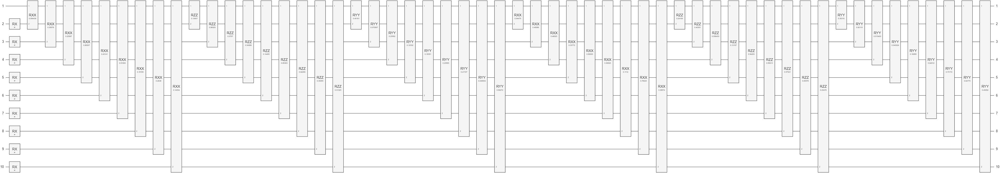

# Quantum Neural Network for Time Series  

This example introduces how to implement a parameterized quantum circuit, which is one of quantum neural network, as time series model and train it on 
a classical computer. In addition, it introduces how to run the trained model on a quantum simulator or a QPU provided by Amazon&reg; Web Services (AWS&reg;).

<div align="center">
    
</div>
<div align="center">    
    Fig. An exmaple of Parameterized Quantum Circuit
</div>


## 1. Overview

This example is based on reference [\[1\]](#PaperTimeSerires), which describes how we apply parameterized quantum circuits as quantum neural network for forecasting 
time series signals. This example addresses not only to forecast stock prices but to estimate state of charge of battery from current, voltage and temperature. 

This example consists of the following 3 demos; 

- AppleStock folder offers a MATLAB&reg; script (script_train_logreturn_qnn_model_on_classic_computer.mlx) to reproduce what reference 
[\[1\]](#PaperTimeSerires) descibes using historical stock prices of Apple.       

- BatterySoC\Create_and_TrainModel folder offers a MATLAB script (script_train_dsoc_qnn_model_on_classic_computer.mlx), which imports data generated 
by an example of Simscape Battery&trade;, creates a model to estimate state of charge (strictly speaking, its time-difference) and train it on classical computer. 
For more information about this data source, see reference [\[2\]](#UrlMathWorksSoC).

- BatterySoC\Infer_on_AmazonBraket folder offers a MATLAB script (script_infer_dsoc_on_aws_braket.mlx) to infer state of charge (its time-difference actually) 
on Amazon Braket using the trained model in the 2nd demo.

In the sake of creating and training the model of quantum neural network, there are prepared 2 MATLAB codes, `createPQC.m` and `myPQCLayer.m`, 
in the current directory. The createPQC.m is a MATLAB function to generate parameterized quantum circuit with 1 + (Number of predictors) Qubits 
using X-axis, Y-axis and Z-axis rotation gates. 
The myPQCLayer.m is a MATLAB class invoking createPQC.m and working as a tracable layer of neural network. 
Parameter shift rule (PSR), which is implemented in the `backward` method of `myPQCLayer` class, is the key technique to compute gradient of learnable parameters 
when training the prediction models. Regarding PSR, see references [\[3\]](#PaperExtendedPSR), [\[4\]](#PaperGeneralPSR) and [\[5\]](#UrlPennylanePSR).


## 2. Requirements

### Products

- MATLAB R2026a
- Deep Learning Toolbox&trade; 
- Parallel Computing Toolbox&trade;  
- Statistics and Machine Learning Toobox&trade;
- [MATLAB Support Package for Quantum Computing](https://www.mathworks.com/matlabcentral/fileexchange/125425-matlab-support-package-for-quantum-computing)

If you have already used the support package, we recommend to update because simulation for parameterized quantum circuits was improved in July 2026.

### Preparation to run this example
#### a. Environment variables to access Amazon S3
When you use Amazon Braket, it requires to set environment variables to access Amazon S3&trade; on MATLAB 
because the output returned from quantum device is exported to your bucket in Amazon S3 as a file of JSON format. 
Concretely, the following environment variables are required:

- `AWS_DEFAULT_REGION`
- `AWS_ACCESS_KEY_ID` 
- `AWS_SECRET_ACCESS_KEY` 
- `AWS_SESSION_TOKEN` [Option]

Run *`setenv`* to set the environment variable. For instance, you run in case of setting AWS_DEFAULT_REGION as follows:

```matlab:Code
setenv(AWS_DEFAULT_REGION = "ap-northeast-1")
```

The value which region you should specify depends on the location of S3 bucket you are going to use.
For more information, see [Work with Remote Data](https://www.mathworks.com/help/matlab/import_export/work-with-remote-data.html)


#### b. Add the root folder to search path
Run ADDPATH as follows in advance before trying this example, if there are createPQC.m and myPQCLayer.m in the current directory:

```matlab:Code
addpath(pwd)
```


## References

<a id="PaperTimeSerires">1</a>. Dimitrios Emmanoulopoulos and Sofija Dimoska. "[Quantum Machine Learning in Finance: Time Series Forecasting](https://arxiv.org/abs/2202.00599)" (2022) 

<a id="UrlMathWorksSoC">2</a>. MathWorks, "[Battery State-od-Charge Estimation](https://www.mathworks.com/help/simscape-battery/ug/battery-state-of-charge-estimation.html)" (Modified February 28, 2026) 

<a id="PaperExtendedPSR">3</a>. Zhijian Lai, Jiang Hu, Dong An, and Zaiwen Wen. "[Extended Parameter Shift Rules with Minimal Derivative Variance for Parameterized Quantum Circuits](https://arxiv.org/abs/2508.08802)" (2025) 

<a id="PaperGeneralPSR">4</a>. Wierichs, David, Josh Izaac, Cody Wang, and Cedric Yen-Yu Lin. "[General Parameter-Shift Rules for Quantum Gradients](https://quantum-journal.org/papers/q-2022-03-30-677/)" (2022) 

<a id="UrlPennylanePSR">5</a>. PENNYLANE, "[Parameter-shift Rule](https://pennylane.ai/qml/glossary/parameter_shift)" (Modified February 25, 2026) 

